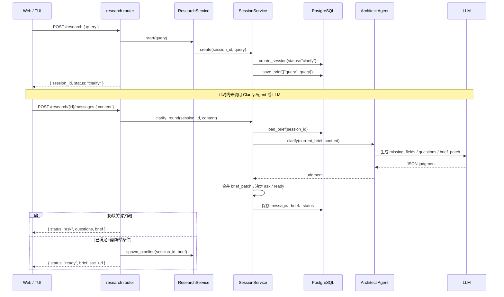

# Clarify 当前实现数据流

> **状态：代码现状快照（2026-10-04）**。
>
> 本文用于定位实现与目标设计之间的差异，不是客户端 API 契约。正式目标以
> [Research API 契约](../contracts/research-api.md) 为准；端到端目标数据流见
> [架构数据流](../architecture/dataflow.md)。

## 当前链路

当前 `POST /research` 只创建会话和保存原始 query，不执行 LLM Clarify。首次
Clarify 会在客户端随后调用 `POST /research/{session_id}/messages` 时才发生。

## 代码责任边界

- `backend/interface/router/research.py`：HTTP 入口；在当前实现中，`ready` 后直接启动 pipeline。
- `backend/application/research_service.py`：创建 session ID，并将 pipeline 作为后台任务启动。
- `backend/application/session_service.py`：保存会话、串行化每轮 Clarify、合并 brief patch、持久化状态。
- `backend/domain/research/agents/architect.py`：通过 LLM 产出 `missing_fields`、`questions` 与 `brief_patch`，不决定状态。
- `backend/domain/research/machine.py`：当前以 `decision_goal`、`research_object`、`deliverable` 三个关键字段决定 `ask` 或 `ready`。
- `backend/infrastructure/storage/postgres.py`：持久化 session、消息和 brief。

## 已知目标偏差

当前实现的状态序列为 `clarify → ask → ready`。它与正式契约的
`ask → confirm → ready` 不一致：

1. 初始 `POST /research` 应执行 `clarify_initial` 并返回 `ask` 或 `confirm`，当前只返回 `clarify`。
2. `confirm` 应展示完整 ResearchBrief 并等待用户显式确认；当前没有 confirm 端点，满足旧规则后直接启动 pipeline。
3. 当前响应使用 `brief`，且没有 `missing_fields`、`clarification_round`；正式契约使用 `brief_draft` 或 `research_brief`。

因此，面向正式契约实现的客户端收到 `{ status: "clarify" }` 时应将其报告为契约错误，而不能猜测下一步。
